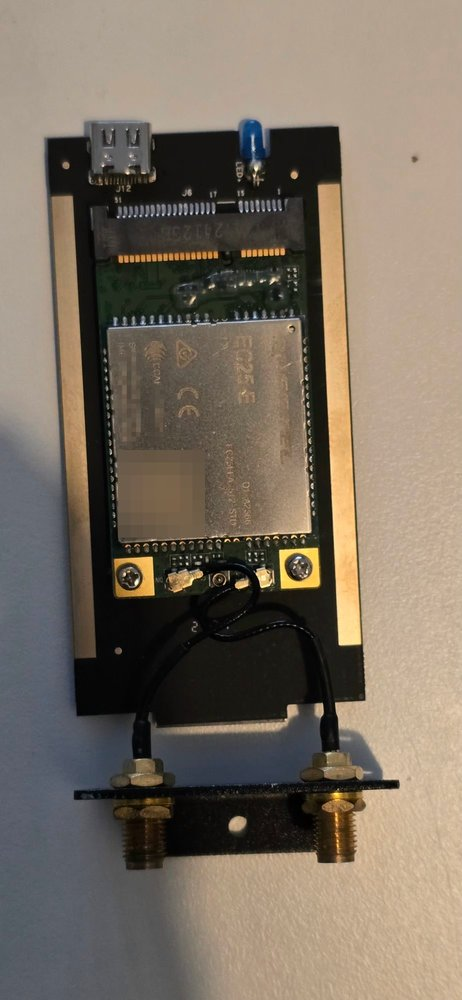
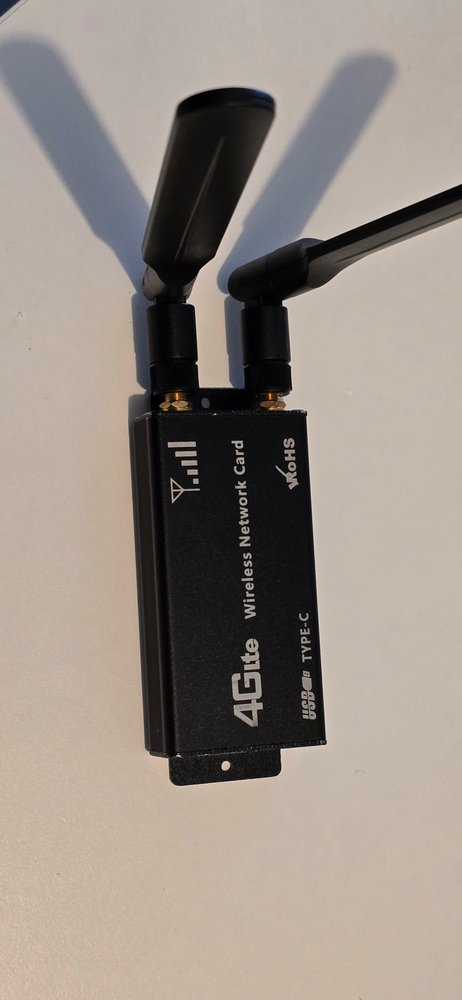
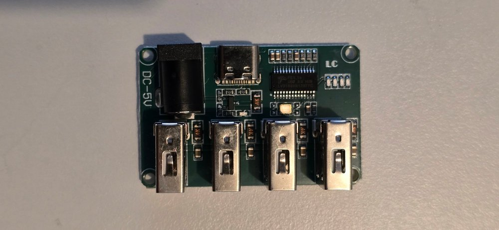
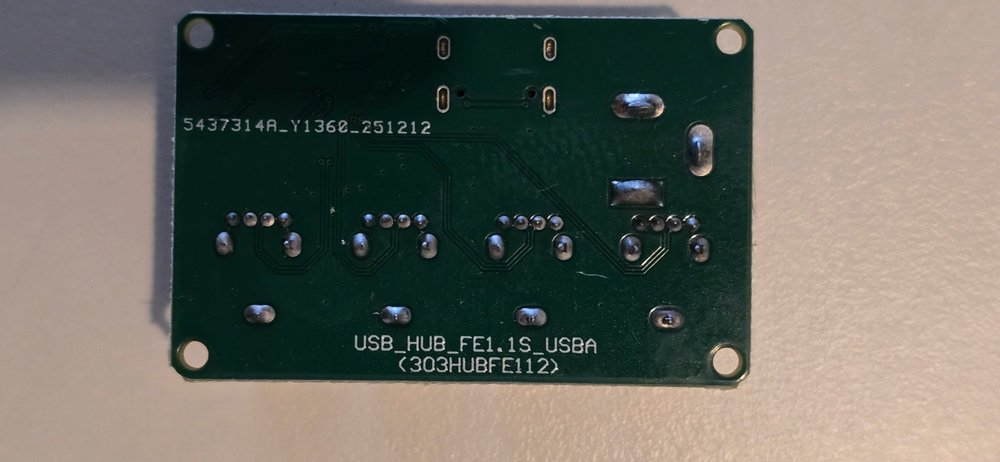

# Hardware

## Reference set-up

The gateway is developed and tested on this hardware:

| Part | Model | Notes |
|---|---|---|
| Host | Raspberry Pi 3 Model B+ | Raspberry Pi OS (Debian 13), 64-bit (aarch64) |
| Module | Quectel **EC25-E**, mini PCIe | firmware `EC25EFAR06A10M4G`, USB id `2c7c:0125` |
| Adapter | mini PCIe to USB-C adapter in an aluminium case ("4G LTE Wireless Network Card, USB Type-C"), standard-size SIM slot, two SMA connectors | USB 2.0, powered by the USB port only |
| Hub | 4-port USB 2.0 hub board, FE1.1s chip, USB-C upstream port and 5 V barrel jack (board marked `USB_HUB_FE1.1S_USBA`, USB id `1a40:0101`) | powered through its 5 V jack: recommended, see [Power](#power) |
| Antennas | two LTE antennas on the SMA connectors: main and diversity (u.FL cables inside the case) | no network registration without the main antenna |

Other hosts should work but are **not tested**: Raspberry Pi 4 or 5, or any amd64/arm64 Linux
machine with Docker. Other EC25 variants (EC25-A, -AU, -J...) use the same AT commands; pick the
one for your region's bands. The EG25-G probably works too, untested.

| | |
|---|---|
|  |  |
| EC25-E in the adapter (labels with identifiers masked) | the adapter closed, with its two antennas |

| |
|---|
|  |
|  |
| the hub board: 5 V jack and USB-C upstream port at the top, four USB-A ports |

Keep the identifiers of your own module private: the IMEI and the serial number are printed on
its label, also in the square 2D code.

## The EC25 on USB

Once USB audio is enabled (next section), the module shows 9 USB interfaces:

| Interface | Linux device | Use |
|---|---|---|
| 0 | `/dev/ttyUSB0` | diagnostics (DM) |
| 1 | `/dev/ttyUSB1` | NMEA (GPS); also the PCM voice port of `MODEM_AUDIO=serial` |
| **2** | `/dev/ttyUSB2` | **AT commands: used by the gateway** |
| 3 | `/dev/ttyUSB3` | modem (PPP) |
| 4 | network interface (`wwan0`) | mobile data (QMI), not used by the gateway |
| 5 | | ADB |
| **6-8** | ALSA card `Android` | **USB audio (UAC): the voice of calls** |

The `ttyUSBn` numbers change with the order in which devices appear. The gateway uses the
stable link `/dev/serial/by-id/usb-Android_Android-if02-port0` (interface 2), whatever the USB
port or hub port the module is plugged into. No udev rule is needed.

Check on the host:

```
lsusb -d 2c7c:0125                 # Quectel EC25
ls -l /dev/serial/by-id/           # usb-Android_Android-if00-port0 ... if03-port0
cat /proc/asound/cards             # a card named "Android" (only with USB audio enabled)
```

The sound card takes 8000 Hz, mono, 16-bit only: the EC25 has no wideband (HD) voice over USB.

## Enable USB audio (once)

Out of the box the EC25 has no USB audio interface. The setting below is stored in the module
and survives restarts; it only has to be done once per module.

1. Stop the gateway (`docker compose stop`) and make sure nothing else uses the AT port
   (ModemManager, see [INSTALL.md](INSTALL.md)).
2. Open the AT port with a serial terminal, for example:

   ```
   sudo apt install picocom
   sudo picocom -c /dev/serial/by-id/usb-Android_Android-if02-port0
   ```

   `-c` echoes what you type. Quit with `Ctrl-A` then `Ctrl-X`.
3. Read the current USB configuration:

   ```
   AT+QCFG="USBCFG"
   ```

   The module answers `+QCFG: "usbcfg",0x2C7C,0x0125,<diag>,<nmea>,<at>,<modem>,<rmnet>,<adb>,<uac>`.
   The last value is USB audio (UAC). The quotes around `USBCFG` are required: without them
   the module answers `ERROR`.
4. If the last value is `0`, write the same values back with the last one set to `1`, then
   restart the module:

   ```
   AT+QCFG="USBCFG",0x2C7C,0x0125,<diag>,<nmea>,<at>,<modem>,<rmnet>,<adb>,1
   AT+CFUN=1,1
   ```

   The reference module reports and uses `AT+QCFG="USBCFG",0x2C7C,0x0125,1,1,1,1,1,1,1`
   (every interface on). The gateway needs the AT port (`<at>` = 1) and UAC (`<uac>` = 1).
   The module disconnects from USB and comes back after a few seconds, with the `Android`
   sound card.

## SIM card

- **Remove the PIN code** of the SIM before using it (in a phone). The driver does not enter a
  PIN: with a PIN set, the log shows `Needs PIN code!` and the module stays unusable.
- A standard-size SIM in the reference adapter. Insert or remove it only with the module
  unplugged.
- The subscription must allow voice calls and SMS. Voice over LTE (VoLTE) and the fallback to
  3G for calls depend on the operator and on the module's firmware.

## Power

The module draws current peaks during calls and at network registration. With a weak supply
the module resets or disappears from USB, often during a call.

- Use a good power supply for the Pi (the official 5.1 V, 2.5 A supply for a Pi 3).
- Plug the module through a **powered** USB hub (the reference hub has a 5 V jack for its own
  supply), or check that the Pi's supply has margin.
- Use a **short, good-quality USB cable** between the adapter and the hub or the Pi. A long or
  thin cable drops the voltage during the current peaks, and the module resets in the middle
  of a call, while everything looks fine at rest.
- Check for past under-voltage on a Raspberry Pi:

  ```
  vcgencmd get_throttled
  ```

  `throttled=0x0` is fine. Bits 0 and 2 mean under-voltage and throttling right now; bits 16
  and 18 mean they happened since the last boot (`0x50000`: both happened).

## Host

- **ModemManager** must not run: it opens the AT ports of the module and competes with the
  gateway (`sudo systemctl disable --now ModemManager`).
- The container shares `/dev` with the host and may only open serial ports (major 188) and
  sound devices (major 116): the module can be unplugged, reset or come back under another
  `ttyUSBn` without restarting the container.
